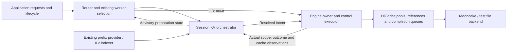

# Session-aware KV cache orchestration: implementation and evaluation

Implementation update for [SGLang RFC #45189](https://github.com/sgl-project/sglang/issues/45189). Prepared on November 6, 2026. This report describes the `rfc-kvc` implementation and its recorded experiments; the interfaces remain subject to upstream review.

We implemented session and branch tracking in the Router, explicit `PREFETCH`, `DEMOTE`, and `PIN` operations, HiCache execution integration, and bounded lifecycle scheduling. In five held-out paired runs with Qwen3-8B, Mooncake TCP, `mem-fraction-static=0.8`, and a logical working set 1.51 times the target L2 capacity, the lifecycle strategy achieved:

| Primary result | Change relative to on-demand recovery |
| --- | ---: |
| Effective task throughput | **+31.58%** |
| Throughput including allocated source-publication time | **+22.52%** |
| Pooled p95 time to first token (TTFT) | **−26.42%** |
| Recomputed prefix tokens | **−99.82%** |
| Storage GET API payload | **−22.44%** |

Both strategies completed 8,960 resumptions, with matching outputs and successful control cleanup for all 17,920 tasks. The 95% bootstrap interval for the mean of five paired throughput improvements was **[24.71%, 38.97%]**. Pooled p99 TTFT increased **3.36%**, so the latency improvement does not extend to every tail statistic.

This comparison measures two strategies within the same instrumented implementation. It is not a comparison against an unmodified upstream SGLang checkout. The primary configuration disables automatic short PINs and skips DEMOTE during its short tool waits. A separate experiment exercises all three actions and reports a throughput regression.

## 1. Design and execution contracts

An application can identify which context belongs to a session, when a tool is running, and when a task may resume. That information can help decide when to recover KV and where to retain it. Moving a read before a request arrives can reduce its critical-path wait, but it also consumes host capacity and storage service earlier. Wrong predictions can introduce transfers and evict useful KV.

Our objective is to reduce the recovery and recomputation costs actually paid by later requests under finite capacity. Cache hit rate and preparation completion are intermediate observations; task throughput, latency, and resource costs determine the outcome.

The implementation follows the RFC's separation of application lifecycle, Router intent, Engine execution, and backend capabilities. In this report, **L1** is GPU KV, **L2** is the Engine-managed host cache, and **L3** is external HiCache storage. A backend's own internal tiers are separate from this naming.



The Router retains bounded logical state: task incarnations, immutable branch revisions, prefix associations, interests, operations, claims, and observations. Content identity includes weight namespace, salt, layout, page geometry, and components. Replica location and Engine epoch are separate from content identity. Finishing a task withdraws its interests and releases its claims; other tasks can continue using shared content.

The Engine owns physical approval and mutation. It checks capacity, active references, in-flight transfers, and supported paths. Background workers perform storage I/O; the cache owner publishes usable data and releases references through existing HiCache mechanisms. The design adds no separate transfer service.

| Action | Contract | Implemented boundary relevant to this evaluation |
| --- | --- | --- |
| `PREFETCH` | Prepare a definite scope at a destination; report the actual reusable scope and location. | The primary path is compatible L3→L2 recovery followed by ordinary L2→L1 load-back. Completion provides a point-in-time observation; continued protection requires PIN. |
| `DEMOTE` | Preserve a colder copy and reclaim eligible source scope; report those effects separately. | Includes host-only FULL L2→L3 reclamation for eligible leaves or suffixes. GPU-resident duplicates, shared ancestors, protection, and active references can block reclamation. |
| `PIN` | Apply finite protection with explicit conditions, scope, TTL, renewal, and release. | Engine L2 eviction exclusion and explicit Mooncake L3 soft-pin integration. Backend conditions remain visible; soft-pin is not an unconditional residency guarantee. |

The versioned hint envelope is reused. The concrete action names are `sglang.prefetch`, `sglang.demote`, and `sglang.pin`. Independent controls and request-attached hints share interpretation and capability checks. Unknown or unsupported paths produce explicit outcomes. Protocol definitions and shared fixtures are in `sgl-router/sgl-kv-orchestrator/` and `python/sglang/srt/managers/kv_control/`.

Execution results distinguish requested, accepted, ready, preserved, reclaimed, missing, and blocked scopes. A successful backup does not imply that source capacity was freed. Cancellation requests drainage; memory remains owned until the underlying operation is quiescent. A lost reply is retried with the same wire identity, while a new lifecycle episode receives a fresh identity. Gaps, restarts, or incompatible epochs invalidate affected observations. Unknown state is reconfirmed before reporting readiness.

L3 protection uses one backend-protection writer per protection domain, aggregating per-caller claims. Multi-Router automatic failover and persistent session metadata are outside the tested deployment model.

## 2. Implementation and optimizations

The branch retains the original `rfc-kvc` history and its upstream integration. The changes reuse existing cache pools, storage adapters, completion handling, protection registries, and Router worker selection. New policy behavior is optional; capability checks constrain the paths that can execute.

| Area | Implementation |
| --- | --- |
| Logical state and action contracts | `sgl-router/sgl-kv-orchestrator/src/`: session index, target resolution, operation/interest tracking, observations, backend protection, and preparation-cost samples. |
| Router integration | `sgl-router/src/orchestration/`: lifecycle inputs, worker selection inputs, capability discovery, bounded scheduling, Engine queries, and readiness publication. |
| Engine integration | `python/sglang/srt/managers/kv_control/`: schema validation, control service, finite claims, queries, and feedback. |
| Cache execution | `python/sglang/srt/mem_cache/unified_cache/`, `unified_radix_cache.py`, and `managers/cache_controller.py`: reads, safe publication, transfer ownership, protection, and reclamation. |
| Evaluation | `benchmark/session_kv_control/`: lifecycle replay, raw request/control journals, cost analysis, and independent result verification. |

**Read budgets and demand reuse.** Native reads have optional page-aligned total-in-flight and speculative-in-flight token budgets, plus a host admission reserve for real demand. The total-read admission gate considers ordinary recovery occupancy before admitting native work. Ordinary requests retain their existing recovery path, so this is not a universal hard cap on every storage read.

A matching ordinary `wait_complete` request can join a queued or active native restore using exact compatible scope, encoded salt, and extra-key identity. The read is charged once, and real demand changes its scheduling classification without creating a second GET. Cancellation of one logical interest preserves work needed by others. Temporary publication holds hand data into ordinary match/load-back admission. Native scheduling preserves same-salt serialization and GPU transfer ordering, with a background opportunity after a bounded burst of demand admissions. Submitted GETs are not preempted.

These budgets currently cover in-flight work. They do not provide a complete accounting limit for every prepared but unconsumed cache resident.

**Preparation timing.** A bounded model groups observed preparation cost by worker, owner epoch, compatibility/backend namespace, and prefix-size bucket. It uses a recent quantile with a bounded lead and a configured cold-start estimate. Observed duration includes control, admission, storage recovery, publication, and observation delay. Incomplete terminal samples are retained as lower bounds and counted separately; the quantile is consequently not an exact I/O service-time estimate.

A lifecycle recovery window starts at Router API ingress. Mailbox delay and worker discovery consume the same absolute window. Once every live interest's window has expired, never-attempted preparation falls back to on-demand recovery. Attempted or uncertain work retains its identity and drain obligations. A new future interest can reopen a never-attempted local fallback; cancellation remains irreversible for a cancelled episode.

**Control-path overhead.** Repeated serial Engine queries were costly in early pressure experiments. The implementation now negotiates a bounded `read_batch` capability: up to eight existing read commands are executed in one owner turn. All child contexts are prevalidated. Router consumers still validate scope, epoch, feedback tickets, and watermarks. Events can advance state within a batch, so the reply is not treated as an atomic snapshot. Older Engines and recovery cases retain the serial path.

The Router also reuses fresh advisory observations and drained terminal receipts where valid. Planning an automatic preparation can reuse an already discovered healthy worker's capabilities; the first actual write still checks fresh capabilities and compatibility.

The background pump alternates one eligible due storage→host preparation with ordinary job round-robin. It selects the earliest due preparation with a live future interest and advances it before independent worker probing. A separate round-robin cursor preserves progress for cancellation, PIN expiry, and uncertain I/O. There is still at most one selected job per pump turn. No parallel control scheduler was introduced.

**Retention and demotion.** Optional short host PINs use a separate finite child operation and a conservative Router budget, with Engine physical approval remaining authoritative. Overlapping ranges can be charged more than once by the Router. A preparation episode attempts one lease; it does not repeatedly reacquire protection after expiry.

Lifecycle DEMOTE requires pressure/wait evidence and sufficient expected cold residency. The host-only path confirms or writes a compatible L3 copy, waits for I/O completion, and rechecks references and protection on the owner before reclaiming the eligible source range. Preservation and reclamation remain independently visible. Short waits skip the demote/read-back cycle.

**Observability and measurement fixes.** Bounded counters cover ordinary/native storage query and GET costs, requested/completed payload, physical jobs, waiting reasons, reservations, and host capacity. Epoch-checked counter deltas are separate from gauges. GET payload describes backend API-addressed KV; network wire bytes remain unknown. Sampled L2 byte-seconds include staging and reference occupancy, with no gap or boundary extrapolation.

The harness treats explicit integer `cached_tokens=0` with null details as a full zero hit, preserving the absence of details. Missing or invalid nonzero metadata remains an error. It also retains normal late-preparation fallback, null pre-submission receipts, and every cleanup rejection. Only the exact structured non-quiescent ACK rejection is retried, within the original deadline.

Each feature was reviewed, tested, and committed separately. Representative commits are listed in Section 9; historical failed experiments were retained.

## 3. Correctness and integration testing

Tests cover state and ownership as well as output consistency. The following are recorded focused validations at the relevant implementation snapshots; overlapping suites must not be added into a single total.

| Validation | Recorded result | Coverage |
| --- | --- | --- |
| Final Router due-priority tests | 5 passed | Earliest due selection, stale/cancelled/unhealthy exclusion, fairness for 6/9-job sets, legacy behavior, and actual HTTP call ordering. |
| Final Router orchestration HTTP regression | 54 passed | Lifecycle association, shared interests, cancellations, retries, epoch/layout changes, scoped readiness, batch fallback, PIN lifecycle, and backend-owner interactions. |
| Engine batch/service/feedback/protection regression | 49 passed, 47 subtests passed | Strict bounds, recursive/write rejection, context prevalidation, HTTP/msgpack transport, error isolation, and state changes between batch entries. |
| Rust core, protocol, and association validation for absolute windows | 50 passed; 1 optional live test ignored | Identity/compatibility, bounded history, interest bookkeeping, and protocol behavior. |
| Benchmark HTTP and drain tools | 41 passed | Exact ACK retry, one cancellation, original deadline, persistent rejection, other errors, and preservation of raw failures. |
| Host occupancy integral | 15 passed | Hand-computed areas, absent/changed byte units, ambiguous pools, invalid capacity, and coverage boundaries. |
| Real GPU/file/Mooncake integration | 2 passed, 2 subtests passed | Actual transfer/recovery paths with the configured backends. |
| Separate exact GPU K/V recovery test | 1 passed | Distinct per-layer K and V values, storage demotion, eligible host reclamation, restoration, and elementwise equality. |
| Rust 1.92.0 release Clippy and formatting | Passed | Router `--lib --tests`, `-D warnings`, and workspace formatting. Python tools passed selected Ruff/isort and formatting checks. |

Host DEMOTE tests additionally exercise shared ancestors, blocked GPU duplicates, valid PIN and computation references, radix splits during writes, foreign H2D references, partial writes, missing prior backups, unsupported endpoints, and cancellation during storage work. Failed writes or cancellation cannot be reported as successful reclamation.

Model-output checks compare every resumption against a warm-GPU source reference for the identical input and fixed output length. Cold-prefill and warm-cache BF16 execution can differ numerically; the earlier cold/warm differences are retained. The separate elementwise K/V test checks data movement directly. Output agreement alone is not used as proof of byte-exact transfer.

Proof logs indexed by the evidence manifest include `proofs/due-priority-parent-unit.log.gz`, `proofs/due-priority-parent-http-final.log.gz`, `proofs/due-priority-parent-clippy-tests.log.gz`, `proofs/read-batch-parent-tests.log.gz`, and `proofs/gpu-host-demote-exact-tests-v4.log.gz`.

This validation does not constitute a full upstream CI run across all hardware, attention types, parallelism modes, or production serving configurations.

## 4. Performance experiment

### Deployment

| Parameter | Recorded configuration |
| --- | --- |
| Model | Qwen3-8B, BF16, FULL attention |
| Engines | Two independent TP=1/PP=1/DP=1 Engines on one host |
| Source A / target B | A100 80GB PCIe / A100-SXM4-80GB; every paired comparison uses the same target B |
| GPU memory setting | `mem-fraction-static=0.8`; no explicit `max-total-tokens` cap |
| Target L1 / L2 capacity | 346,944 / 693,952 tokens, measured from the running Engine |
| HiCache | ratio 2; persistent host cache; direct I/O; page_first_direct; write_through; wait_complete |
| Storage | Mooncake 0.3.14, TCP; `global_segment_size=128GB` per Engine; task-owned Master |
| Execution | Overlap disabled; prefill/decode graph backends explicitly disabled; deterministic inference enabled; Triton attention and PyTorch sampling |
| Request shape | 16,384-token published prefix plus one synthetic tool-result token; 32 output tokens |
| Other limits | context 32,768; page 64; chunked prefill 4096; max running requests 32 |
| Native read limits | 4 reads; total-in-flight 131,072 tokens; speculative-in-flight 65,536; demand host reserve 32,768 |
| Router policy | poll 250ms; p90; 128 groups; 32-sample window; 4-sample minimum; max lead 10s; margin 250ms |
| Primary retention settings | automatic ready PIN TTL=0; minimum cold residency=3000ms; tool wait=3s |

The GPU memory setting is the configured static fraction, not a claim that active KV occupancy is always 80%. The actual working set is **64 × 16,384 = 1,048,576 tokens**, or **1.51× L2**. L2 sampled occupancy reached 100% in on-demand and 99.16% in lifecycle. Hardware differs between A and B; source cost is shared and target B is fixed across both strategies.

The legacy `disable_cuda_graph` field is false in recorded metadata. Actual prefill/decode backend arguments are `disabled`, and startup/runtime logs confirm graph execution was disabled. Both facts are retained in the provenance.

### Inputs, controls, and timing

We compare `on_demand` with `lifecycle`. Both perform task start, input association, and task finish through the Router. Only lifecycle supplies preparation events. Inference is sent directly to the fixed target B; the control path goes through the Router. Earlier functional tests exercised Router placement, but these performance numbers do not measure free routing or distributed-indexer throughput.

Each pair uses 64 distinct synthetic ledger prefixes, replayed 28 times per strategy: 1,792 resumptions per arm. Five predeclared seeds—200001, 210001, 220001, 230001, 240001—produce 320 distinct held-out prefixes. Actual prefix hashes are checked against screening, supplemental, and other held-out inputs. Adjacent seeds would overlap because input generation uses `seed + case`; disjoint ranges were therefore chosen before held-out execution.

Every pair starts a fresh Router with an empty cost model and a fresh run ID/salt. Each arm starts with a cold target cache; natural GPU/host residency and eviction proceed throughout that arm. The order is determined by the predeclared seed: on-demand first in pairs 1/3/5, lifecycle first in pairs 2/4. Parameters and binaries remain fixed across the five pairs.

For each pair, source A performs an initial generation and a warm reference generation for every prefix, with real L3 publication. The arms reuse this immutable source material within the pair. This is suitable for this retained L3 working set; it should not be reused unchanged in an experiment where L3 protection or source retention is the variable under study.

Resumption appends one fixed synthetic tool-result token to the published page-aligned prefix. Without that extra token, generating from an identical prefix can force recomputation of its final page for logits, confounding the recovery metric. The synthetic input rule is recorded; real tool-output distributions were not evaluated.

The clients are closed-loop with concurrency 32. Resumption timing is anchored to the actual 3-second tool deadline and is not postponed to wait for preparation. Control backlog can cause backpressure, which is recorded. After a task's inference finishes, its control cleanup proceeds asynchronously; every outstanding operation drains before the arm ends.

Let `N` be valid completed resumptions, `W` the arm's work time, and `S` the source-publication execution time shared by the pair:

```text
Effective work throughput = N / W
Complete-job throughput   = N / (W + S / 2)
Paired throughput change  = 100 × (lifecycle throughput / on-demand throughput − 1)
```

`W` includes registration, tool waits, control backpressure, inference, and final drain. The second metric additionally allocates real source generation/publication cost. Lab cache resets, process startup, input construction, and offline analysis are outside these metrics. Complete-job throughput is this explicit accounting definition, not a measured trainer throughput.

Each arm was required to complete at least 1000 resumptions and 600 seconds of work. Across five pairs, each strategy had to complete at least 5000 resumptions and 3600 work seconds. No idle waiting was added to meet duration thresholds.

## 5. Results and interpretation

### Throughput and latency

| Metric | On-demand | Lifecycle | Change |
| --- | ---: | ---: | ---: |
| Valid completed resumptions | 8960 | 8960 | All valid |
| Total work time | 5480.828s | 4165.503s | −24.00% |
| Effective work throughput | 1.6348 tasks/s | 2.1510 tasks/s | **+31.58%** |
| Complete-job throughput | 1.2519 tasks/s | 1.5338 tasks/s | **+22.52%** |
| Mean TTFT | 11.077s | 5.659s | −48.91% |
| Pooled p95 TTFT | 25.712s | 18.918s | **−26.42%** |
| Pooled p99 TTFT | 31.426s | 32.483s | **+3.36%** |
| Mean request end-to-end latency | 15.201s | 9.122s | −39.99% |
| Pooled p95 request end-to-end latency | 32.504s | 22.651s | −30.31% |
| Recomputed prefix tokens | 9,169,472 | 16,384 | −99.82% |
| Confirmed prepared before actual request dispatch | 0 | 626 | 6.99% of lifecycle resumptions |

Request end-to-end latency measures generation dispatch through final output. It excludes the preceding tool wait and task registration, which remain included in work throughput. The p99 and request end-to-end rows were independently recomputed from all archived per-request rows when preparing this report; their source hashes and values are recorded in `results/2026-11-05-lifecycle-v2/community-report-metrics.json`.

| Pair seed | Order | On-demand work | Lifecycle work | Work throughput change | p95 TTFT change |
| --- | --- | ---: | ---: | ---: | ---: |
| 200001 | on-demand → lifecycle | 1129.885s | 856.066s | +31.99% | −23.04% |
| 210001 | lifecycle → on-demand | 1027.040s | 862.148s | +19.13% | −17.12% |
| 220001 | on-demand → lifecycle | 1118.153s | 785.564s | +42.34% | −39.98% |
| 230001 | lifecycle → on-demand | 1088.546s | 782.538s | +39.10% | −29.53% |
| 240001 | on-demand → lifecycle | 1117.203s | 879.186s | +27.07% | −19.24% |

All five pairs improved work throughput and p95 TTFT. The arithmetic mean of paired throughput improvements is **31.93%**, with a percentile-bootstrap 95% interval of **[24.71%, 38.97%]**, using 4000 resamples of complete pairs. The aggregate throughput change of 31.58% is a different statistic. For complete-job throughput, the paired mean is 22.67%, interval [17.41%, 27.40%]. Pooled percentiles are calculated from all requests, not by averaging pair percentiles. Five pairs provide limited statistical resolution, and requests within a pair are not independent experimental replicates. The reported p99 increase is a pooled point estimate; no separate p99 uncertainty interval was preregistered or computed.

The strategies accumulated 91.35 and 69.43 work minutes respectively. All preregistered correctness, count, duration, throughput (+5%), paired-interval, and p95-regression (at most +5%) gates passed. P99 was reported but was not the preregistered latency gate.

### Storage and host-memory cost

| Work-interval observation | On-demand | Lifecycle |
| --- | ---: | ---: |
| GET API-addressed payload, decimal TB | 13.4538 | 10.4344 |
| L3 missing tokens | 0 | 0 |
| Native jobs created | 0 | 2866 |
| Native loaded tokens, cumulative per operation | 0 | 24,379,392 |
| Native demand-coalescing events | 0 | 2168 |
| Observed host occupancy integral, 10¹⁴ byte·s | 5.4559 | 4.1189 |
| Integral coverage | 5471.507s | 4152.864s |
| Mean host occupancy over covered samples, decimal GB | 99.715 | 99.181 |
| Sampled peak host occupancy fraction | 100.00% | 99.16% |
| Target B observed CPU, core·s/task | 1.6960 | 1.3146 |
| Router observed CPU, core·s/task | 0.03099 | 0.04556 |

All ten arm-level storage deltas passed same-epoch and counter-consistency checks. GET payload fell 22.44%; network wire traffic and complete GET+PUT cost were not measured. Both arms had zero L3 missing tokens, so this experiment supplies no L3 capacity-competition evidence for soft-pin retention.

The host occupancy integral fell 24.51%, largely alongside shorter work time. Mean occupancy changed little. This cannot be interpreted as a 24.51% reduction in required L2 capacity. The integral includes staging and reference occupancy, and coverage excludes unknown boundaries or gaps.

Router average observed CPU increased from about 0.051 to 0.098 cores. Target B used fewer observed CPU seconds per task. Engine/Router CPU coverage was at least 99.56%; incomplete sampler-child intervals and unmeasured driver CPU are not extrapolated into full-machine totals.

Only 626 resumptions were observed fully prepared before request dispatch. This polling-based count is not a complete census of physical I/O completion times. There were also 5,479 task-level preparation records with normal policy fallback; their inference results and control costs remain in the reported totals. Fallback is not an inference failure and does not establish that no earlier shared work occurred. The results support the combined mechanism of overlapping recovery, sharing in-flight work, and avoiding repeated prefill. They do not isolate the fraction caused by each mechanism. Ordinary recovery can lose host residency between publication and GPU admission; the native demand handoff avoids some such loss. Improving the ordinary path may reduce the relative prefetch advantage while improving both absolute performance and the comparison baseline.

## 6. Three-action experiment and retained negative results

The primary 3-second wait and 3-second minimum-cold-residency guard skip lifecycle DEMOTE. Automatic short PIN is disabled. The positive primary result therefore establishes lifecycle preparation benefit in this configuration, without establishing a benefit from enabling all three actions together.

A separate seed9031 experiment used 30-second tool waits, 64 prefixes, two passes, concurrency 32, and a 1000ms automatic host PIN. All **384 resumptions and cleanup records passed**. Work times were:

| Strategy | Work time | Throughput change vs. on-demand |
| --- | ---: | ---: |
| On-demand | 175.030s | reference |
| Fixed prefetch | 175.418s | −0.22% |
| Lifecycle with three-action opportunities | 179.849s | **−2.68%** |

Observed DEMOTE wire operations, deduplicated by physical message identity:

| Outcome | Operations | Observed scope |
| --- | ---: | --- |
| Completed reclamation | 11 | 180,224 tokens reclaimed |
| Partial: preserved but blocked | 13 | 212,992 tokens; 10 operations blocked by GPU residency and 3 by active references |
| Missing source | 65 | No source reclamation |
| Total preservation across completed/partial operations | 24 | 393,216 tokens preserved |

These are summed operation ranges, not concurrent unique memory occupancy. We also observed 29 automatic PIN child operations, with latest receipts reporting 28 expired and 1 released. Expiry alone does not prove a PIN was unused. PREFETCH had 107 observed wire operations with completed latest receipts. Logical task interests and physical operations have different counts because of sharing and repeated lifecycle episodes.

The high fraction of missing DEMOTE targets indicates avoidable control work and motivates fresh candidate filtering. GPU/reference-blocked results correctly preserve their source. This single supplemental pair cannot attribute its throughput regression separately to PIN, DEMOTE, or control overhead. It is excluded from the primary statistics and duration gates.

We retained earlier screening failures and regressions as well:

| Screening configuration | Work throughput change | Why it was not accepted as a final result |
| --- | ---: | --- |
| poll50 / automatic PIN1000ms | −9.9% | Throughput regression; p95 also regressed. |
| poll250 before ACK-tool correction | +25.3% | One control ACK failed; original failure retained. |
| Cached capability planning, poll250 / PIN1000ms | +11.75% | p95 TTFT increased 53.47%. |
| Same code with automatic PIN disabled | +11.25% | p95 TTFT increased 23.26%. |
| Due-priority scheduling, poll250 / PIN disabled | +14.52% | p95 increased 4.87%; selected for held-out evaluation, still a single screening pair. |

An earlier long-run attempt was excluded after cancellation-sharing conflicts: 1664 generated outputs agreed, but 17 control outcomes failed. The fixes preserve cancellation monotonicity and explicitly fall back for the affected automatic preparation. New held-out inputs and fresh cost models were used afterward. Cross-version absolute timing differences are not treated as single-factor causal estimates.

Fixed-lead prefetch was included in screening and the supplemental experiment, but not in the five-pair primary evaluation. This report does not establish that the adaptive policy outperforms a well-tuned fixed lead.

## 7. Reproduction and evidence

Recorded performance snapshots:

- Engine: `5a683b6667727ce96ef6e80594cc537f1c84faca`.
- Router and benchmark: `565de9e13240bc4bcd941d389de7c0f98fb8c856`.
- Router binary SHA-256: `2264751478e38f3bf5fe7e5bfd5f69a2955cff284900fdff1139d923d7322acd`.
- Later duration-harness extension: `436f4c0c4a`; its new mode was not used to obtain the performance numbers above.

Commit IDs identify implementation-branch snapshots, not upstream release tags. Full configuration, model identity, serving dependency provenance, and checksums are recorded separately. The serving Mooncake package was verified using the Engine launcher's actual import path; a different package installed in the HTTP driver's environment was not the serving SDK.

With compatible task-owned services already running and the recorded policy/Engine budgets configured, a primary pair can be launched from the repository root as follows. Substitute local model and configuration paths, and read the control bearer through the environment:

```bash
python benchmark/session_kv_control/lifecycle_bench.py \
  --router http://127.0.0.1:52910 \
  --router-control-key-env SGL_ROUTER_CONTROL_BEARER \
  --engine-a http://127.0.0.1:52801 --engine-b http://127.0.0.1:52803 \
  --model "$MODEL_PATH" --router-budget-file "$ROUTER_CONFIG" \
  --host-capacity-tokens 693952 \
  --blocks 1 --arms on_demand,lifecycle --cases 64 --passes 28 \
  --prefix-tokens 16384 --concurrency 32 --output-tokens 32 \
  --tool-wait-s 3 --fixed-lead-s 2.5 --poll-ms 100 \
  --timeout-s 180 --cleanup-timeout-s 180 \
  --reuse-published-sources --demote-under-pressure \
  --seed 200001 --min-arm-seconds 600 --min-arm-resumes 1000 \
  --output "$RESULT_DIR"
```

`--poll-ms 100` above is the benchmark client's poll interval; Router policy polling is separately configured to 250ms. `--fixed-lead-s` is inactive when the fixed-prefetch arm is absent. `--demote-under-pressure` reports pressure, while the 3-second cold-residency guard skips the primary DEMOTE. Use the actual measured host capacity if reproducing on different hardware; a different capacity defines a different experiment.

Repeat for the five declared seeds, using an empty Router cost model and a new run ID per pair and a cold target cache per arm. The harness does not launch or own the services. A single invocation with five blocks in one unchanged Router would not reproduce the per-pair model resets.

The checked-in result directory is `benchmark/session_kv_control/results/2026-11-05-lifecycle-v2/`. It contains `summary.json`, `formal-design.json`, `cost-summary.json`, `three-action-effects.json`, `source-provenance.json`, `verification.json`, and the evidence manifest. Full request/control journals, closed resource files, service logs, failed screens, and proof logs are retained in an external archive: **324 files, about 2.19 GB compressed / 15.37 GB original**. That archive is currently retained in the experiment workspace; the checked-in manifest is not itself a public download of the raw files.

Given an extracted archive, verify it without contacting online services:

```bash
python benchmark/session_kv_control/results/2026-11-05-lifecycle-v2/verify_results.py \
  --archive "$ARCHIVE_ROOT" --verify-hashes --deep
```

The verifier checks hashes, decompressed originals, source separation, model resets, per-request output/control ledgers, count/duration gates, pooled p95, and paired intervals. Original evidence remains unchanged. Measurement failures and normal fallback stay visible. At experiment completion, all task-owned operations, claims, reads, and backend uncertainty were drained; the Router, two Engines, Master, and observers were stopped and their ports/GPU allocations checked.

A later `--duration-s` harness mode sustains closed-loop admission until a deadline and drains all admitted work afterward. Its 27 focused tests passed. No additional performance result from that mode is claimed here, and a long run by itself does not demonstrate saturation.

## 8. Remaining work and applicability

The measured gain is specific to a FULL/TP1 persistent-host configuration, synthetic 16K contexts, short fixed tool waits, fixed output length, TCP storage, disabled overlap/graphs, and controlled target placement. It should be re-evaluated with supported production execution settings. TP/PP/DP, hybrid attention/cache layouts, RDMA, disaggregated serving, and multi-Router recovery require separate support and validation.

The following work has the clearest basis in current evidence:

1. **Bound ordinary publication-to-consumption handoff.** Prevent recoverable data from disappearing before GPU admission, within an explicit capacity budget. Re-measure the incremental value of prefetch against that improved on-demand baseline.
2. **Filter DEMOTE candidates using fresh scoped evidence.** Avoid missing or presently unreclaimable targets while retaining owner-side revalidation. Measure saved control work and actual recovered capacity; do not manufacture reclamation by evicting useful GPU data.
3. **Account for prepared but unconsumed residency.** Add a bounded physical-scope ledger with shared-interest and consumption attribution. In-flight limits alone cannot prevent wrong predictions from accumulating completed speculative cache.
4. **Evaluate timing and PIN under uncertainty.** Distinguish missing size and load, test early/late resumes, cancellations, longer tool outputs, shared branches, and non-reused sessions. Tie PIN decisions to expected consumption and eviction pressure. Preserve the public separation of readiness and protection.
5. **Measure external effects.** Mix ordinary foreground traffic, impose L3 retention competition, run sustained/open-arrival tests, and integrate a real rollout consumer or trainer. Lower TTFT is insufficient evidence of reduced training wait when storage recovery is already overlapped with other work.

GPU-resident host duplicate reclamation, overlapping-range job merging, submitted-GET preemption, and automatic L3 candidate ranking remain deferred. The current implementation deliberately keeps those reference and scheduling changes out of the tested path.

## 9. Contribution structure and review references

The implementation history is organized by feature. These commits are review landmarks; an upstream PR series would need to be rebased or integrated against its chosen upstream revision and pass the corresponding CI.

| Feature | Implementation commit(s) |
| --- | --- |
| Ordinary/native read-cost and capacity observations | `6d102ac4b8` |
| Read budgets, demand priority, background fairness | `acc163e3a0` |
| Bounded grouped preparation cost | `f5640888af` |
| Host-only storage demotion and reclamation | `d4bade6739` |
| Exact GPU K/V restoration test | `0265dcc4b4` |
| Fresh wire episodes and bounded short PIN | `7e7962ffa0`, `8897e68356` |
| Minimum cold residency and observation reuse | `92e45056e6`, `e35f78493b`, `d44946b5de` |
| Negotiated Engine/Router batch observations | `5a683b6667`, `61284379d0` |
| Absolute recovery windows | `053f7c2708` |
| Cancellation fallback and exact ACK-tool retry | `4a87f0d239`, `198b1e53ec` |
| Planning discovery reuse and fair due priority | `c83df36928`, `565de9e132` |
| Paired workload/cost analysis and reproducible acceptance | `534f71fd20`, `26516932c9`, `800990225b`, `c0cb6a1d89` |

We would particularly value upstream feedback on the Engine control capability boundary, publication-to-demand ownership, and the smallest useful division between observation, execution primitives, and optional Router policy.

Repository references, relative to this document:

- [Action and execution contracts](../../sgl-router/sgl-kv-orchestrator/README.md).
- [Engine profile and configuration](../../python/sglang/srt/managers/kv_control/README.md).
- [Benchmark methodology](LIFECYCLE_BENCH.md).
- [Recorded acceptance report](results/2026-11-05-lifecycle-v2/REPORT.zh-CN.md).
- [Primary results and paired intervals](results/2026-11-05-lifecycle-v2/summary.json).
- [Frozen configuration](results/2026-11-05-lifecycle-v2/formal-design.json).
- [Resource-cost summary](results/2026-11-05-lifecycle-v2/cost-summary.json).
- [Evidence checksums](results/2026-11-05-lifecycle-v2/evidence-manifest.json).
- [Source and dependency provenance](results/2026-11-05-lifecycle-v2/source-provenance.json).
- [Additional per-request latency calculations](results/2026-11-05-lifecycle-v2/community-report-metrics.json).
