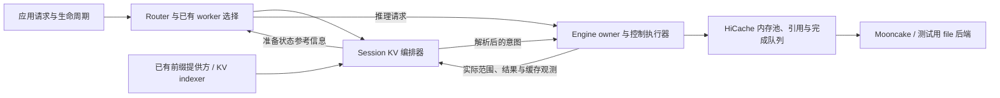

# 面向会话的 KV 缓存编排：实现与测试报告

本文是 [SGLang RFC #45189](https://github.com/sgl-project/sglang/issues/45189) 的实现进展报告，整理日期为 2026-11-06，对应[英文完整报告](COMMUNITY_REPORT.md)。报告描述 `rfc-kvc` 分支的实现与已记录实验，接口仍需经过上游社区评审。

我们实现了 Router 侧的会话与分支追踪、显式 `PREFETCH`、`DEMOTE`、`PIN` 操作、HiCache 执行适配，以及有界生命周期调度。在五轮独立测试集的配对实验中，使用 Qwen3-8B、Mooncake TCP、`mem-fraction-static=0.8`，逻辑工作集为目标 L2 容量的 1.51 倍，生命周期策略取得以下结果：

| 主要指标 | 相对按需恢复的变化 |
| --- | ---: |
| 有效任务吞吐 | **+31.58%** |
| 包含源发布时间分摊的吞吐 | **+22.52%** |
| 合并 p95 首 token 延迟（TTFT） | **−26.42%** |
| 前缀重复计算 tokens | **−99.82%** |
| 存储 GET API 请求的数据量 | **−22.44%** |

两种策略分别完成 8,960 次恢复，全部 17,920 个任务的输出一致性与控制收尾均通过。五轮配对吞吐提升均值的 bootstrap 95% 区间为 **[24.71%, 38.97%]**。合并 p99 TTFT 增加了 **3.36%**，延迟改善没有覆盖全部尾部统计量。

本实验比较同一套已接入观测能力的实现中的两种策略，尚未与未修改的上游 SGLang 做性能对照。主配置关闭自动短 PIN，并在短工具等待期间跳过 DEMOTE。另有一组实际执行三种操作的独立补测，其吞吐出现退化。

## 1. 设计与执行契约

应用知道上下文属于哪个会话、工具何时运行，以及任务可能何时恢复。这些信息可以帮助决定 KV 的恢复时机和保留位置。将读取提前到请求到达之前，可以减少关键路径上的等待，同时也会更早占用 host 容量和存储服务。预测错误可能增加搬运，并驱逐其他有用的 KV。

我们的目标是在有限容量下，减少后续请求实际承担的恢复与重复计算成本。缓存命中率和准备完成状态属于中间观测，最终通过任务吞吐、延迟和资源成本判断收益。

实现遵循 RFC 对应用生命周期、Router 意图、Engine 执行和后端能力的职责划分。本文中，**L1** 指 GPU KV，**L2** 指 Engine 管理的 host cache，**L3** 指 HiCache 接入的外部存储。存储后端内部的 DRAM、SSD 等层级有各自的含义，不与这套命名混用。



Router 维护有界逻辑状态，包括任务实例、不可变分支版本、前缀关联、需求记录（interest）、操作、保护声明（claim）和观测。内容身份包含权重 namespace、salt、layout、page 几何与 component。副本位置和 Engine epoch 独立于内容身份。任务结束时撤销该任务的需求并释放其保护，其他任务仍可继续使用共享内容。

物理审批和缓存修改由 Engine 负责。Engine 检查容量、活动引用、在途传输和支持的执行路径。后台线程执行存储 I/O，缓存所有者（owner）通过已有 HiCache 机制发布可用数据并释放引用。设计没有增加独立的数据搬运服务。

| 操作 | 契约 | 与本次评估相关的实现边界 |
| --- | --- | --- |
| `PREFETCH` | 在指定目标准备明确范围，报告实际可复用范围和位置。 | 主路径为兼容的 L3→L2 恢复，之后通过普通 L2→L1 load-back 使用。完成结果描述观测时刻的状态，持续保护需要 PIN。 |
| `DEMOTE` | 保存冷层副本并回收符合条件的源范围，分别报告两种效果。 | 支持 FULL 模式下 host-only 叶节点或合法后缀的 L2→L3 回收。GPU 驻留重复副本、共享祖先、保护和活动引用可能阻止回收。 |
| `PIN` | 提供有限时间的保护，明确条件、范围、TTL、续期和释放语义。 | 包括 Engine L2 普通驱逐排除，以及显式 Mooncake L3 soft-pin 适配。后端保护条件保留在结果中，soft-pin 不提供无条件驻留保证。 |

控制消息复用已有的版本化 hint envelope，具体动作名为 `sglang.prefetch`、`sglang.demote`、`sglang.pin`。独立控制和请求附带 hints 共用动作解释及能力检查。未知或不支持的路径返回明确结果。协议定义和跨语言共享测试数据位于 `sgl-router/sgl-kv-orchestrator/` 与 `python/sglang/srt/managers/kv_control/`。

执行结果区分 requested、accepted、ready、preserved、reclaimed、missing、blocked 范围。备份成功不能作为源容量已释放的证据。取消会请求操作排空，在底层工作达到 quiescent、确认不再使用对应内存之前，相关内存仍保留所有权。响应丢失后沿相同线上消息身份重试，新的生命周期执行轮次使用新身份。事件缺口、重启和不兼容 epoch 会使相关观测失效；未知状态须重新确认后才能报告就绪。

每个 L3 保护域只有一个后端保护写入者，负责聚合各调用方的 claim。多 Router 自动接管和持久化会话元数据不在本次测试的部署模型内。

## 2. 实现与优化

分支保留原有 `rfc-kvc` 提交历史及其上游合入历史。改动复用已有缓存池、存储适配器、完成处理、保护注册表和 Router worker 选择。新增策略通过配置启用，实际可执行路径受能力检查约束。

| 范围 | 实现位置与职责 |
| --- | --- |
| 逻辑状态与动作契约 | `sgl-router/sgl-kv-orchestrator/src/`：会话索引、目标解析、操作与需求追踪、观测、后端保护、准备成本样本。 |
| Router 集成 | `sgl-router/src/orchestration/`：生命周期输入、worker 选择输入、能力发现、有界调度、Engine 查询、就绪状态发布。 |
| Engine 集成 | `python/sglang/srt/managers/kv_control/`：schema 校验、控制服务、有限保护、查询与反馈。 |
| 缓存执行 | `python/sglang/srt/mem_cache/unified_cache/`、`unified_radix_cache.py`、`managers/cache_controller.py`：读取、安全发布、传输所有权、保护与回收。 |
| 评估 | `benchmark/session_kv_control/`：生命周期重放、原始请求与控制日志、成本分析、独立结果校验。 |

**读取预算与真实需求复用。** 原生控制读取（native read）可配置按 page 对齐的总在途 token 预算、推测在途 token 预算，以及为真实需求保留的 host 准入余量。总读取准入检查会在批准新的 native 工作前计入普通恢复的占用。普通请求仍使用已有恢复路径，因此该检查并非所有存储读取共同遵守的硬上限。

普通 `wait_complete` 请求在范围、编码后的 salt 和 extra-key 身份精确兼容时，可以加入排队或执行中的 native 恢复。物理读取只计费一次，真实需求的加入改变其调度类别，不创建第二次 GET。撤销某个逻辑需求不会取消其他需求仍在使用的工作。发布期间的临时引用将数据移交到普通 match/load-back 准入过程。native 调度保留同 salt 串行与 GPU 传输顺序，并在有界连续 demand 准入后给后台工作一次推进机会。已提交的 GET 不支持抢占。

当前预算覆盖在途工作，尚未对全部已准备但未消费的缓存驻留提供完整限额与归因。

**准备时机。** 有界成本模型按 worker、owner epoch、兼容性与后端 namespace、前缀大小桶分组。模型使用近期分位数、最大提前量和配置的冷启动估计。观测耗时包含控制处理、准入、存储恢复、发布和观察延迟。未完整完成的终态样本按耗时下界保留，并单独计数；所得分位数不能直接解释为精确 I/O 服务时间。

生命周期恢复窗口从 Router API 入口开始计算。mailbox 排队和 worker 能力发现消耗同一个绝对窗口。所有存活需求的窗口均过期后，从未尝试的准备正常退回按需恢复。已经尝试或结果不确定的工作继续保留原身份和排空义务。新的未来需求可以重新推进从未尝试的本地退回任务，已取消执行轮次的取消状态仍不可逆。

**控制路径开销。** 早期压力实验中，重复串行 Engine 查询产生明显成本。实现通过能力协商启用有界 `read_batch`，在一轮 owner 处理中顺序执行最多八个已有读命令，并在执行前验证全部子命令上下文。Router 继续校验 scope、epoch、反馈 ticket 和水位。Events 可以在批内推进状态，因此不能将批量回复当作原子快照。旧 Engine 及恢复场景继续使用串行查询。

Router 也会在条件允许时复用新鲜的参考性观测，以及已终结且排空的回执。自动准备的规划阶段可以复用已发现的健康 worker 能力；首次实际写操作仍重新验证当前能力和兼容性。

后台 pump 在符合条件的到期 storage→host 准备与普通 job 轮转之间交替。它选择仍有未来需求且 due 最早的准备，在独立 worker 探测前推进。独立的轮转游标保证取消、PIN 到期和不确定 I/O 仍有机会推进。每轮 pump 仍至多选择一个 job，没有新增并行控制调度器。

**保留与降级。** 可选短 host PIN 使用独立且有限的子操作，并受 Router 保守预算约束，物理批准仍由 Engine 决定。Router 可能重复计入重叠范围。每次准备执行轮次只尝试一次租约，不会在保护过期后反复重新申请。

生命周期 DEMOTE 要求存在压力、等待证据和足够的预计冷层驻留时间。host-only 路径确认或写入兼容 L3 副本，等待 I/O 完成，再由 owner 复核引用和保护，回收符合条件的源范围。保存与回收效果分别可查。短等待会跳过降级后立即读回的往返。

**观测与计量修正。** 有界计数器覆盖普通与 native 存储 query/GET 的成本、请求与完成数据量、物理 job、等待原因、预留和 host 容量。同 epoch 校验后的累计计数增量与瞬时 gauge 分开处理。GET payload 表示后端 API 寻址的 KV 数据量，网络 wire bytes 仍未知。采样 L2 byte-seconds 包含 staging 与引用占用，不对缺口和区间边界外推。

压测工具仅在 `cached_tokens=0` 明确为整数且 details 为 null 时解释为完整零命中，同时保留缺少细节的事实。缺失或非法的非零元数据继续报错。工具完整保留正常准备迟到退回、尚未提交时的 null 回执，以及每次清理拒绝。仅精确匹配结构化 non-quiescent ACK 拒绝时，在原截止时间内重查。

各功能均在审阅、测试通过后独立提交。第 9 节列出代表性提交，历史失败实验完整保留。

## 3. 正确性与集成测试

测试同时覆盖状态、所有权和输出一致性。下表列出相关实现快照上已记录的专项验证结果；测试集合存在重叠，不能将数量相加为总测试数。

| 验证项 | 已记录结果 | 覆盖范围 |
| --- | --- | --- |
| 最终 Router 到期优先专项 | 5 项通过 | 最早 due 选择，排除失效、取消和不健康目标，6/9 个 job 集合的公平性，旧策略行为，实际 HTTP 调用顺序。 |
| 最终 Router 编排 HTTP 回归 | 54 项通过 | 生命周期关联、共享需求、取消、重试、epoch/layout 变化、范围就绪、批量查询退回、PIN 生命周期和后端 owner 交互。 |
| Engine 批量查询、服务、反馈、保护回归 | 49 项通过，47 个子测试通过 | 严格数量限制、递归与写命令拒绝、上下文预检、HTTP/msgpack 传输、错误隔离、批内状态变化。 |
| 绝对窗口对应的 Rust 核心、协议和关联验证 | 50 项通过，1 项可选 live 测试忽略 | 身份与兼容性、有界历史、需求记账、协议行为。 |
| 压测 HTTP 与排空工具 | 41 项通过 | 精确 ACK 重试、取消一次、原截止时间、持续拒绝、其他错误、原始失败保留。 |
| host 占用时间积分 | 15 项通过 | 手算面积、字节单位缺失或变化、多池歧义、非法容量、覆盖边界。 |
| 真实 GPU/file/Mooncake 集成 | 2 项通过，2 个子测试通过 | 配置后端下的实际搬运与恢复路径。 |
| 独立精确 GPU K/V 恢复测试 | 1 项通过 | 各层 K/V 使用不同值，覆盖存储降级、合法 host 回收、恢复及逐元素一致性。 |
| Rust 1.92.0 release Clippy 与格式 | 通过 | Router `--lib --tests`、`-D warnings`、workspace 格式；Python 工具通过选定的 Ruff/isort 和格式检查。 |

host DEMOTE 测试还覆盖共享祖先、GPU 重复副本受阻、有效 PIN 与计算引用、写入期间 radix 分裂、其他操作持有的 H2D 引用、部分写入、历史备份缺失、不支持的目标端点，以及存储工作执行期间取消。写入失败或取消不能被报告为成功回收。

模型输出校验将每次恢复与相同输入、固定输出长度的源端暖 GPU 参考结果比较。BF16 下冷 prefill 与暖缓存执行可能出现数值差异，早期实验中的这类差异仍保留。独立的逐元素 K/V 测试直接检查数据搬运，不能只凭模型输出一致推断字节级传输正确。

证据清单索引了相关日志，包括 `proofs/due-priority-parent-unit.log.gz`、`proofs/due-priority-parent-http-final.log.gz`、`proofs/due-priority-parent-clippy-tests.log.gz`、`proofs/read-batch-parent-tests.log.gz` 和 `proofs/gpu-host-demote-exact-tests-v4.log.gz`。

这些验证不等同于覆盖全部硬件、attention 类型、并行模式和生产配置的完整上游 CI。

## 4. 性能实验

### 部署配置

| 参数 | 已记录配置 |
| --- | --- |
| 模型 | Qwen3-8B，BF16，FULL attention |
| Engine | 同一主机上两台独立 TP=1/PP=1/DP=1 Engine |
| 源 A / 目标 B | A100 80GB PCIe / A100-SXM4-80GB；每个配对使用相同目标 B |
| 显存设置 | `mem-fraction-static=0.8`，无显式 `max-total-tokens` 上限 |
| 目标 L1 / L2 容量 | 从运行中 Engine 实测为 346,944 / 693,952 tokens |
| HiCache | ratio 2；persistent host cache；direct I/O；page_first_direct；write_through；wait_complete |
| 存储 | Mooncake 0.3.14，TCP；每 Engine `global_segment_size=128GB`；实验独占 Master |
| 执行配置 | overlap 关闭；prefill/decode graph backend 显式关闭；开启 deterministic inference；Triton attention 与 PyTorch sampling |
| 请求形状 | 已发布的 16,384-token 前缀加一个合成工具结果 token；输出 32 tokens |
| 其他限制 | context 32,768；page 64；chunked prefill 4096；max running requests 32 |
| native 读取限制 | 最多 4 个读取；总在途 131,072 tokens；推测在途 65,536；demand host 余量 32,768 |
| Router 策略 | poll 250ms；p90；128 个分组；32 个样本的窗口；最少 4 个样本；最大提前量 10s；余量 250ms |
| 主场景保留配置 | 自动 ready PIN TTL=0；最小冷层驻留 3000ms；工具等待 3s |

显存设置指配置的静态比例，不能据此认为活动 KV 占用始终为 80%。实际逻辑工作集为 **64 × 16,384 = 1,048,576 tokens**，约为 **L2 的 1.51 倍**。L2 采样占用峰值在按需组达到 100%，生命周期组达到 99.16%。A、B 硬件不同，源成本共享分摊，两种策略固定使用相同目标 B。

记录中的旧字段 `disable_cuda_graph` 为 false。实际 prefill/decode backend 参数均为 `disabled`，启动和运行日志也确认未执行 CUDA graph。两类信息都保留在来源记录中。

### 输入、对照与计时

实验比较 `on_demand` 与 `lifecycle`。两组均通过 Router 执行任务开始、输入关联和任务结束，生命周期组额外提供准备事件。推理请求直接发送到固定目标 B，控制请求经过 Router。早期功能测试覆盖 Router 选路，但本次性能数字不能代表自由路由或分布式 indexer 吞吐。

每轮配对使用 64 个不同的合成 ledger 前缀，每种策略重复使用 28 次，即每组 1,792 次恢复。五个预声明种子 200001、210001、220001、230001、240001 生成 320 个独立测试前缀。实际前缀哈希会与筛选、补测和其他独立轮次核对隔离。输入生成使用 `seed + case`，相邻种子会产生重叠，因此在独立测试开始前便选定不相交的种子范围。

每轮配对都启动空成本模型的新 Router，使用新 run ID/salt。每组从目标冷缓存开始，组内 GPU/host 按自然驻留与驱逐运行。组顺序由预声明种子决定：第 1/3/5 轮按需组先运行，第 2/4 轮生命周期组先运行。五轮的参数和二进制保持不变。

每轮源 A 为各前缀执行一次初始生成和一次暖缓存参考生成，并实际发布到 L3。轮内两组复用这批不可变源材料。该方式适用于本次能够保留源工作集的 L3 条件；如果实验变量是 L3 保护或源端保留，则不能直接沿用这套复用方式。

恢复输入在已发布、page 对齐的前缀后追加一个固定合成工具结果 token。如果输入完全相同，生成 logits 可能要求重算前缀末页，进而混淆恢复计量。合成输入规则已经记录，本轮未评估真实工具输出分布。

客户端采用并发 32 的请求循环，每条任务完成后继续发起后续任务。恢复时刻以真实 3 秒工具截止时刻为基准，不为等待准备而推迟。控制积压造成的背压会记录。任务推理完成后，控制清理异步继续；该组结束前，所有未完成操作必须排空。

设 `N` 为完成且有效的恢复请求数，`W` 为组工作时间，`S` 为配对两组共享的源发布执行时间：

```text
有效工作吞吐 = N / W
完整作业吞吐 = N / (W + S / 2)
配对吞吐变化 = 100 × (生命周期吞吐 / 按需吞吐 − 1)
```

`W` 包含任务注册、工具等待、控制背压、推理和期末排空。完整作业吞吐额外分摊实际源生成与发布成本。实验缓存重置、进程启动、输入构造和离线分析不计入这两项。完整作业吞吐采用上述明确的计量定义，不能解释为已测训练吞吐。

每组要求至少完成 1000 次恢复、600 秒有效工作。五轮累计每种策略至少完成 5000 次恢复、3600 秒有效工作，不通过空闲等待补足时长。

## 5. 结果与解释

### 吞吐与延迟

| 指标 | 按需恢复 | 生命周期策略 | 变化 |
| --- | ---: | ---: | ---: |
| 有效完成恢复数 | 8960 | 8960 | 全部有效 |
| 累计工作时间 | 5480.828s | 4165.503s | −24.00% |
| 有效工作吞吐 | 1.6348 tasks/s | 2.1510 tasks/s | **+31.58%** |
| 完整作业吞吐 | 1.2519 tasks/s | 1.5338 tasks/s | **+22.52%** |
| 平均 TTFT | 11.077s | 5.659s | −48.91% |
| 合并 p95 TTFT | 25.712s | 18.918s | **−26.42%** |
| 合并 p99 TTFT | 31.426s | 32.483s | **+3.36%** |
| 平均请求端到端延迟 | 15.201s | 9.122s | −39.99% |
| 合并 p95 请求端到端延迟 | 32.504s | 22.651s | −30.31% |
| 前缀重复计算 tokens | 9,169,472 | 16,384 | −99.82% |
| 实际请求发送前确认准备完成 | 0 | 626 | 生命周期恢复数的 6.99% |

请求端到端延迟从生成请求发出计时，到完整输出结束，不含此前的工具等待和任务注册；这两部分仍计入工作吞吐。p99 和请求端到端延迟是在编写本报告时，从全部已归档逐请求记录独立复算得到，来源哈希和数值位于 `results/2026-11-05-lifecycle-v2/community-report-metrics.json`。

| 配对种子 | 顺序 | 按需工作时间 | 生命周期工作时间 | 工作吞吐变化 | p95 TTFT 变化 |
| --- | --- | ---: | ---: | ---: | ---: |
| 200001 | 按需 → 生命周期 | 1129.885s | 856.066s | +31.99% | −23.04% |
| 210001 | 生命周期 → 按需 | 1027.040s | 862.148s | +19.13% | −17.12% |
| 220001 | 按需 → 生命周期 | 1118.153s | 785.564s | +42.34% | −39.98% |
| 230001 | 生命周期 → 按需 | 1088.546s | 782.538s | +39.10% | −29.53% |
| 240001 | 按需 → 生命周期 | 1117.203s | 879.186s | +27.07% | −19.24% |

五轮的工作吞吐和 p95 TTFT 均有改善。配对吞吐提升的算术均值为 **31.93%**；以完整配对轮次为单位进行 4000 次 percentile bootstrap 重采样，95% 区间为 **[24.71%, 38.97%]**。合计吞吐变化 31.58% 属于另一项统计量。完整作业吞吐的配对提升均值为 22.67%，区间为 [17.41%, 27.40%]。合并分位数从全部请求计算，不平均各轮分位数。五轮样本的统计分辨率有限，同轮请求不能视为独立实验重复。p99 增加是合并样本的点估计，未预注册或另行计算 p99 不确定区间。

两种策略累计有效工作时间分别为 91.35 和 69.43 分钟。所有预注册的正确性、请求数、时长、吞吐至少提升 5%、配对区间支持改善，以及 p95 退化不超过 5% 的门槛均通过。p99 作为报告指标披露，不属于预注册延迟验收门槛。

### 存储与 host 内存成本

| 工作区间观测 | 按需恢复 | 生命周期策略 |
| --- | ---: | ---: |
| GET API 寻址数据量，十进制 TB | 13.4538 | 10.4344 |
| L3 缺失 tokens | 0 | 0 |
| native job 创建数 | 0 | 2866 |
| native loaded tokens，按操作累计 | 0 | 24,379,392 |
| native demand 合并事件数 | 0 | 2168 |
| 实测 host 占用时间积分，10¹⁴ byte·s | 5.4559 | 4.1189 |
| 积分覆盖时长 | 5471.507s | 4152.864s |
| 覆盖样本内平均 host 占用，十进制 GB | 99.715 | 99.181 |
| host 占用比例采样峰值 | 100.00% | 99.16% |
| 目标 B 观测 CPU，core·s/task | 1.6960 | 1.3146 |
| Router 观测 CPU，core·s/task | 0.03099 | 0.04556 |

十个组的存储计数增量均通过同 epoch 与计数一致性校验。GET payload 减少 22.44%；本轮未测量网络线上的实际字节数，也未完整测量 GET+PUT 成本。两组 L3 缺失均为零，因此无法用该实验判断 soft-pin 在 L3 容量竞争下的保留收益。

host 占用时间积分减少 24.51%，主要随工作时间缩短。平均占用变化很小，不能据此解释为所需 L2 容量减少 24.51%。积分包含 staging 和引用占用，未知边界与采样缺口不计入覆盖。

Router 平均观测 CPU 从约 0.051 核增加到 0.098 核。目标 B 的每任务观测 CPU 秒数下降。Engine/Router 的 CPU 采样覆盖至少 99.56%；采样器子进程的不完整区间和未测驱动客户端 CPU 不外推为整机总量。

只有 626 次恢复在请求发出前被观测为完整准备完成。这个基于轮询的数量不等于物理 I/O 完成时刻的完整统计。另外有 5,479 条任务级准备记录发生正常策略退回，其推理结果与控制成本仍包含在汇总中。策略退回不等于推理失败，也不能据此认为此前没有发生共享工作。结果支持恢复重叠、在途工作共享、减少重复 prefill 的组合收益，尚未分离各机制的贡献比例。普通恢复可能在 host 发布与 GPU 准入之间丢失驻留，native demand 移交避免了一部分此类损失。改进普通路径可能缩小预取的相对优势，同时改善两组绝对性能和对照基线。

## 6. 三动作实验与保留的负结果

主场景工具等待为 3 秒，最小冷层驻留门槛也为 3 秒，因而跳过生命周期 DEMOTE；自动短 PIN 同样关闭。主实验的正收益证明了该配置下生命周期准备的价值，尚未证明同时启用三种操作的净收益。

独立 seed9031 实验采用 30 秒工具等待、64 个前缀、两次遍历、并发 32，以及 1000ms 自动 host PIN。全部 **384 次恢复与收尾记录通过**。工作时间如下：

| 策略 | 工作时间 | 相对按需恢复的吞吐变化 |
| --- | ---: | ---: |
| 按需恢复 | 175.030s | 对照 |
| 固定提前量预取 | 175.418s | −0.22% |
| 允许三种动作的生命周期策略 | 179.849s | **−2.68%** |

按物理消息身份去重后的 DEMOTE 操作结果如下：

| 结果 | 操作数 | 观测范围 |
| --- | ---: | --- |
| 完成回收 | 11 | 回收 180,224 tokens |
| 部分完成：保存成功、回收受阻 | 13 | 212,992 tokens；10 次受 GPU 驻留阻挡，3 次受活动引用阻挡 |
| 源缺失 | 65 | 无源回收 |
| 完成与部分完成操作的总保存范围 | 24 | 保存 393,216 tokens |

这些数值为逐操作范围之和，不代表同时物理去重内存占用。还观察到 29 个自动 PIN 子操作，末次回执中 28 个为 expired、1 个为 released；仅凭过期状态不能认定 PIN 未被使用。PREFETCH 观察到 107 个线上操作，其末次回执均为 completed。由于共享和重复生命周期执行，逻辑任务需求数与物理操作数不同。

DEMOTE 目标缺失比例较高，表明存在可避免的控制工作，值得增加基于新鲜证据的候选过滤。GPU 或引用阻挡时，源数据按契约保留。这一轮补测无法将吞吐退化单独归因于 PIN、DEMOTE 或控制开销，且不计入主实验统计和时长门槛。

早期筛选中的失败和退化也完整保留：

| 筛选配置 | 工作吞吐变化 | 未作为最终验收结果的原因 |
| --- | ---: | --- |
| poll50 / 自动 PIN1000ms | −9.9% | 吞吐退化，p95 也退化。 |
| ACK 工具修正前的 poll250 | +25.3% | 一条控制 ACK 失败，保留原始失败。 |
| 能力发现结果复用，poll250 / PIN1000ms | +11.75% | p95 TTFT 增加 53.47%。 |
| 同实现关闭自动 PIN | +11.25% | p95 TTFT 增加 23.26%。 |
| 到期准备优先，poll250 / PIN 关闭 | +14.52% | p95 增加 4.87%；被选入独立测试，但该筛选自身仍只有一个配对。 |

更早的一次长测因共享任务取消冲突而未纳入验收：1664 条生成输出一致，但 17 条控制结果失败。修复保持取消状态的单调性，受影响的自动准备明确退回。之后使用新的独立输入和空成本模型重新测试。跨版本绝对耗时变化不作为单因素因果估计。

固定提前量预取参与了筛选和补测，但没有参与五轮主评估。因此本报告不能证明动态策略超过调好的固定提前量策略。

## 7. 复现与证据

已记录的性能测试源码快照：

- Engine：`5a683b6667727ce96ef6e80594cc537f1c84faca`。
- Router 与压测工具：`565de9e13240bc4bcd941d389de7c0f98fb8c856`。
- Router 二进制 SHA-256：`2264751478e38f3bf5fe7e5bfd5f69a2955cff284900fdff1139d923d7322acd`。
- 后续按时长运行的压测扩展：`436f4c0c4a`；上述性能数字未使用该新模式。

提交 ID 对应实现分支快照，不能当作上游发布标签。完整配置、模型身份、服务依赖来源和校验和另有记录。服务实际使用的 Mooncake 包按 Engine 启动器的真实导入路径核验；HTTP 驱动环境中安装的另一版本未作为服务 SDK。

在兼容、由实验独占的服务已经启动，且配置好已记录策略和 Engine 预算的条件下，可在仓库根目录执行以下命令启动一轮主场景配对。替换本地模型和配置路径，通过环境变量读取控制 bearer：

```bash
python benchmark/session_kv_control/lifecycle_bench.py \
  --router http://127.0.0.1:52910 \
  --router-control-key-env SGL_ROUTER_CONTROL_BEARER \
  --engine-a http://127.0.0.1:52801 --engine-b http://127.0.0.1:52803 \
  --model "$MODEL_PATH" --router-budget-file "$ROUTER_CONFIG" \
  --host-capacity-tokens 693952 \
  --blocks 1 --arms on_demand,lifecycle --cases 64 --passes 28 \
  --prefix-tokens 16384 --concurrency 32 --output-tokens 32 \
  --tool-wait-s 3 --fixed-lead-s 2.5 --poll-ms 100 \
  --timeout-s 180 --cleanup-timeout-s 180 \
  --reuse-published-sources --demote-under-pressure \
  --seed 200001 --min-arm-seconds 600 --min-arm-resumes 1000 \
  --output "$RESULT_DIR"
```

这里的 `--poll-ms 100` 是压测客户端轮询间隔，Router 策略轮询另行配置为 250ms。不运行固定预取组时，`--fixed-lead-s` 不生效。`--demote-under-pressure` 用于报告压力，主场景的 3 秒冷层驻留限制仍会跳过 DEMOTE。在其他硬件上复现时应填写实际 host 容量；容量变化对应不同实验条件。

使用五个声明种子分别运行，每轮使用空 Router 成本模型、新 run ID，各组目标从冷缓存开始。压测工具不启动或管理服务。在未重建 Router 的单次运行中指定五个 blocks，无法复现每轮清空模型的条件。

已提交结果目录为 `benchmark/session_kv_control/results/2026-11-05-lifecycle-v2/`，包含 `summary.json`、`formal-design.json`、`cost-summary.json`、`three-action-effects.json`、`source-provenance.json`、`verification.json` 和证据清单。全部原始请求与控制日志、已停止写入的完整资源记录、服务日志、失败筛选及测试证明另存于外部归档：**324 个文件，约 2.19 GB 压缩后 / 15.37 GB 原文**。归档目前保留在实验工作区，仓库内清单本身不提供原始文件的公开下载。

获得解压后的归档目录后，可在不访问在线服务的情况下校验：

```bash
python benchmark/session_kv_control/results/2026-11-05-lifecycle-v2/verify_results.py \
  --archive "$ARCHIVE_ROOT" --verify-hashes --deep
```

校验程序检查文件哈希、解压原文、输入隔离、成本模型重置、逐请求输出与控制账本、请求数与时长门槛、合并 p95 和配对区间。原始证据不改写，计量失败与正常退回均保留。实验结束后，本任务全部操作、claim、读取和后端不确定状态已排空；Router、两台 Engine、Master 和采样器已停止，并核验相关端口及 GPU 占用。

后续新增的 `--duration-s` 模式会在截止时刻前持续执行客户端请求循环，之后排空全部已准入工作。该模式的 27 项专项测试通过，本报告没有引用该模式的新增性能结果；持续运行时间长也不能单独证明负载饱和。

## 8. 适用范围与后续工作

本次收益适用于已测 FULL/TP1、persistent-host、合成 16K 上下文、短固定工具等待、固定输出长度、TCP 存储、关闭 overlap/graphs，以及受控目标放置。对于支持的生产执行配置，仍需重新评估。TP/PP/DP、Hybrid attention/cache layout、RDMA、分离式服务和多 Router 恢复需要独立实现支持与验证。

当前证据支持优先推进以下工作：

1. **普通发布到消费的有界移交。** 在明确容量预算内，避免可恢复数据在 GPU 准入前丢失。以改进后的按需路径为基线，重新测量预取的增量价值。
2. **使用新鲜范围证据筛选 DEMOTE。** 跳过缺失或当前不可回收的目标，同时保留 owner 执行时复核。统计减少的控制工作和实际回收容量，不通过驱逐有用 GPU 数据制造可回收范围。
3. **补齐已准备、未消费内容的驻留记账。** 建立有界物理范围账本，关联共享需求和消费归因。在途预算无法独立限制错误预测造成的已完成推测缓存累积。
4. **在不确定条件下评估时机与 PIN。** 区分实际缺失量和负载，测试早到、晚到、取消、较长工具输出、共享分支和不再复用的会话。PIN 决策结合预计消费与驱逐压力，继续保持准备就绪和持续保护的公开语义独立。
5. **测量对其他工作及训练消费者的影响。** 混入普通前台流量、施加 L3 保留竞争、运行持续负载与开放到达实验，并接入真实 rollout 消费者或 trainer。如果恢复等待已被其他工作覆盖，TTFT 下降不能单独证明训练等待减少。

GPU 驻留 host 重复副本回收、重叠范围 job 合并、已提交 GET 抢占和自动 L3 候选排序继续后置。本次测试路径没有纳入这些额外的引用与调度变更。

## 9. 提交拆分与评审参考

实现历史按功能拆分。下列提交便于定位评审；准备上游 PR 系列时，仍需与选定上游版本整合，并通过对应 CI。

| 功能 | 实现提交 |
| --- | --- |
| 普通/native 读取成本与容量观测 | `6d102ac4b8` |
| 读取预算、demand 优先、后台公平 | `acc163e3a0` |
| 有界分组准备成本 | `f5640888af` |
| host-only 存储降级与回收 | `d4bade6739` |
| 精确 GPU K/V 恢复测试 | `0265dcc4b4` |
| 新 wire 执行轮次与有界短 PIN | `7e7962ffa0`、`8897e68356` |
| 最小冷层驻留与观测复用 | `92e45056e6`、`e35f78493b`、`d44946b5de` |
| Engine/Router 协商批量观察 | `5a683b6667`、`61284379d0` |
| 绝对恢复窗口 | `053f7c2708` |
| 取消退回与 ACK 工具精确重试 | `4a87f0d239`、`198b1e53ec` |
| 规划复用能力发现与公平的到期优先 | `c83df36928`、`565de9e132` |
| 配对负载、成本分析与可复算验收 | `534f71fd20`、`26516932c9`、`800990225b`、`c0cb6a1d89` |

希望社区重点评审 Engine 控制能力边界、发布到真实请求之间的所有权，以及观测、执行原语和可选 Router 策略之间应如何做最小必要拆分。

以下仓库内参考路径相对于本文：

- [动作与执行契约](../../sgl-router/sgl-kv-orchestrator/README.md)。
- [Engine 运行范围与配置](../../python/sglang/srt/managers/kv_control/README.md)。
- [压测方法](LIFECYCLE_BENCH.md)。
- [已记录验收报告](results/2026-11-05-lifecycle-v2/REPORT.zh-CN.md)。
- [主实验结果与配对区间](results/2026-11-05-lifecycle-v2/summary.json)。
- [冻结配置](results/2026-11-05-lifecycle-v2/formal-design.json)。
- [资源成本摘要](results/2026-11-05-lifecycle-v2/cost-summary.json)。
- [证据校验和](results/2026-11-05-lifecycle-v2/evidence-manifest.json)。
- [源码与依赖来源](results/2026-11-05-lifecycle-v2/source-provenance.json)。
- [补充逐请求延迟计算](results/2026-11-05-lifecycle-v2/community-report-metrics.json)。
